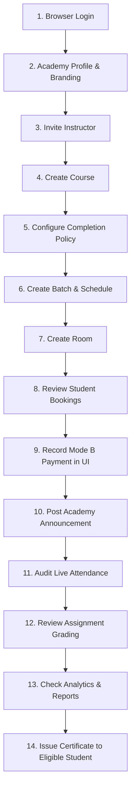

# AIN Platform — Human Pilot Execution Runbook

**Document Version:** 1.0.0  
**Phase:** Human Usability & Production Field Trial  
**Platform Status:** `LIVE PRODUCTION QA DRILL PASSED — HUMAN PILOT PENDING`  
**Target Environment:** Production (`https://all-in-one-production-7c60.up.railway.app`)  

---

## 1. Principles of the Human Pilot

The automated production QA drill confirmed that the technical architecture is fully functional. The human pilot phase tests whether **real people** can use the AIN Platform smoothly, intuitively, and without developer assistance.

### Golden Rules for Pilot Facilitators:
1. **Zero Developer Simulation:**
   No PowerShell scripts, cURL commands, database manipulations, or backend bypasses may be used to perform tasks on behalf of users.
2. **Observe — Do Not Guide Too Much:**
   Allow users to explore the interface naturally. Do not tell them where to click or immediately correct mistakes. Record their initial hesitation, backtracking, and confusion points.
3. **Usability Metrics Focus:**
   Track task completion times, navigation friction, terminology misunderstandings, and UI layout issues across desktop and mobile devices.
4. **Fix Only Blockers (P0 / P1):**
   Do not modify code during the session unless a complete blocker or security failure occurs. Collect UX suggestions and minor friction into the backlog.

---

## 2. Participant Group & Device Requirements

| Role | Count | Required Device(s) | Primary Mission |
| :--- | :---: | :--- | :--- |
| **Academy Owner** | 1 | Laptop / Desktop (Chrome / Safari) | End-to-end academy setup, policy configuration, student admission, payment audit, and certification. |
| **Instructor** | 1 | Laptop / Desktop + Smartphone | Course management, content upload, interactive session scheduling, QR attendance, and assignment grading. |
| **Student 1** | 1 | Smartphone (iOS Safari / Android Chrome) | Complete learning cycle, dynamic QR scanning, quiz examination, assignment submission. |
| **Student 2** | 1 | Smartphone (Android Chrome) | Edge-case attendance testing, late submission, progress monitoring. |
| **Student 3** | 1 | Tablet or Laptop | Full curriculum engagement, PDF review, public certificate verification. |

---

## 3. Operational Prerequisites

Before launching the pilot session with human users:

### 3.1. Transactional Email Provider
Real users must receive authentic transactional emails rather than checking server logs.
- **Supported Providers:** Brevo (Sendinblue), SendGrid, Amazon SES, Mailgun, Postmark.
- **Required Email Templates Verified:**
  1. Instructor / Staff Workspace Invitation
  2. Student Account Registration & Email Verification
  3. Password Reset OTP
  4. Course Enrollment Confirmation & Room Access Details
  5. Live Session Reminder
  6. Course Completion & Certificate Notification

### 3.2. Private Object Storage (Cloudflare R2 / AWS S3)
- Real course PDFs, slides, and assignment attachments must be stored in private object storage.
- Storage must enforce short-lived signed URLs ($\le 15$ minutes) and multi-tenant authorization checks.

### 3.3. Payment Configuration (Mode B — Offline / Manual Payments)
- Mode B is the official payment pathway for this pilot.
- Academy admins will record and audit offline student payments directly from the web UI (`Cash`, `InstaPay`, `Bank Transfer`, `Scholarship`, `Free`).
- Do not simulate or fake credit card transactions through Paymob until live merchant onboarding is complete.

---

## 4. Academy Owner Workflow (Human Test)

The Academy Owner must independently perform the following 14 tasks via the browser:

### Detailed Steps:
1. **Login:** Navigate to `/login`, enter credentials, and complete password rotation if prompted.
2. **Academy Profile:** Go to `/tenant-admin/settings`, upload the academy logo, set brand color, Arabic & English display names, and contact details.
3. **Invite Instructor:** Go to `/tenant-admin/members`, click **New Invitation**, enter the instructor's email, select the `Instructor` role, and send.
4. **Create Course:** Go to `/tenant-admin/courses`, click **Create Course**, define title (Arabic & English), subject, education level, and description.
5. **Configure Completion Policy:** Open course settings, customize academic requirements:
   - Minimum lesson watch percentage (e.g. 80%)
   - Minimum attendance rate (e.g. 75%)
   - Mandatory assignment submissions (Required: Yes)
   - Minimum quiz passing grade (e.g. 70%)
6. **Create Batch:** Set cohort dates, maximum student capacity, and weekly schedule.
7. **Create Room:** Assign the batch to a dedicated interactive learning room.
8. **Review Student Bookings:** Go to `/tenant-admin/bookingRequests`, view incoming enrollment requests.
9. **Record Mode B Payment (Manual Payment UI):**
   - Click **Details** on a pending student booking.
   - Select payment method (`InstaPay` / `Cash` / `Bank Transfer`).
   - Enter reference code (e.g., `INSTA-8849201`) and payment date.
   - Add internal audit notes.
   - Click **Confirm & Record Offline Payment**.
   - Verify that student status updates to `Confirmed` and enrollment is provisioned.
10. **Broadcast Announcement:** Post a welcome message to all enrolled students.
11. **Review Attendance:** View real-time attendance percentages in `/tenant-admin/attendance`.
12. **Review Grading:** Check instructor grading distribution in `/tenant-admin/assignments`.
13. **Analytics Dashboard:** Review revenue, enrollment counts, and active rooms in `/tenant-admin/analytics`.
14. **Issue Certificate:** Once a student reaches 100% eligibility according to the configured policy, click **Issue Certificate** in the certificates dashboard.

---

## 5. Instructor Workflow (Human Test)

The Instructor must independently perform the following 10 tasks via desktop and smartphone:

1. **Accept Invitation:** Open the email invitation link, set up account profile, and log in.
2. **Access Assigned Course:** Open the workspace dashboard and verify that assigned courses appear under **Teaching**.
3. **Enter Learning Room:** Join the course room, check participant roster and chat channel.
4. **Upload Learning Material:** Upload a real syllabus PDF or lesson slides through the browser UI. Verify watermark and viewing permissions.
5. **Create Assignment:**
   - Define assignment title and instructions in Arabic & English.
   - Set maximum score (e.g. 100 points) and submission deadline.
6. **Create Examination Quiz:**
   - Build a 5-question multiple choice & true/false quiz.
   - Set passing threshold (70%) and randomized question delivery.
7. **Schedule Live Session:** Create a live session schedule with title, date, and time.
8. **Generate Dynamic Attendance QR Code:**
   - Launch session attendance.
   - Display dynamic QR code on screen (rotates every 30 seconds).
   - Keep screen visible for students to scan with phones.
9. **Review Submissions:** Open student assignment submissions in the browser viewer.
10. **Grade Assignment:** Enter grade (e.g. 95/100), write feedback in Arabic, and submit.

---

## 6. Student Workflow (Human Test)

Each of the 3 students must complete their journey primarily on **mobile browsers**:

1. **Self-Service Registration:** Register an account or accept invite link on mobile browser.
2. **Log In:** Log into the student portal (`/login`).
3. **Explore Marketplace / Course:** Find the pilot academy course and submit an enrollment booking.
4. **Await Offline Payment Confirmation:** Observe booking status change to `Confirmed` once the Academy Owner confirms payment in Mode B.
5. **Enter My Courses & Room:** Navigate to **My Courses**, enter the interactive room, review announcements.
6. **Watch Video Lesson:** Stream a video lesson, observe video progress tracker update smoothly to $\ge 85\%$.
7. **Open Learning Resource:** Open the instructor's uploaded PDF, confirm clean mobile rendering and watermark display.
8. **Real-World Attendance QR Scan:**
   - Open phone camera or browser scanner in the AIN web app.
   - Scan instructor's on-screen QR code during live session.
   - **Test Scenarios:**
     - *Normal Scan:* Immediate attendance recorded as `Present`.
     - *Duplicate Scan (Student 1):* System alerts "Attendance already recorded for this session".
     - *Expired QR Code (Student 2):* Wait 35 seconds, attempt scan -> alerts "QR code expired, scan refreshed code".
     - *Wrong Student / Unauthorized Device:* Verified rejection with security audit log.
9. **Submit Assignment:** Upload a homework document or photo from phone; verify upload progress and receipt.
10. **Complete Examination Quiz:**
    - Answer quiz questions within time limit on phone.
    - Submit quiz and observe immediate auto-grading and score breakdown.
11. **Review Progress Tracker:**
    - Open course progress modal.
    - Confirm all 4 pillars reflect real user actions:
      - Lessons watched: $\ge 85\%$
      - Attendance: $100\%$
      - Assignment: Submitted & Graded
      - Quiz: Passed
12. **Course Completion Evaluation:** Verify that status updates to `Completed` automatically without developer scripts.
13. **View & Verify Certificate:**
    - Open generated digital certificate on phone.
    - Click **Share Verification Link** or copy verification code.
    - Open an incognito/private browser window without logging in.
    - Verify that the certificate resolves publicly:
      - Student name and course displayed accurately.
      - Student email and phone **never** exposed.
      - Internal UUIDs **hidden**.
      - Grade displayed only if academy setting permits.
      - QA/Test credential watermark/notice clearly visible.

---

## 7. Usability Friction & Observation Protocol

During each user's test session, the observer must maintain a quiet observation log:

| Observation Category | What to Watch For | Metric |
| :--- | :--- | :--- |
| **Task Efficiency** | How long does each screen take to complete? | Time to complete (seconds / minutes) |
| **Discoverability** | Does the user find primary action buttons without hunting? | Wrong clicks, back button presses |
| **Terminology Clarity** | Do educational terms make sense to teachers and students? | Confusion between Course, Batch, Room, Lesson |
| **Mobile Responsiveness** | Are touch targets $\ge 44\text{px}$? Does keyboard obscure inputs? | Form input usability on iOS / Android |
| **Network Resilience** | Does the app recover gracefully on 4G / mobile data? | Offline / reconnect handling |

---

## 8. Post-Pilot Participant Interview

At the conclusion of the session, conduct a 10-minute structured interview with each participant:
1. *What was the easiest part of using the platform today?*
2. *Where did you hesitate or feel confused?*
3. *What did you expect to happen that didn't happen?*
4. *Did any step require too many clicks or feel repetitive?*
5. *Would you be comfortable using this weekly for your real classes?*
6. *If you could change one single thing, what would it be?*

All responses must be documented in `docs/HUMAN_PILOT_RESULTS.md`.
