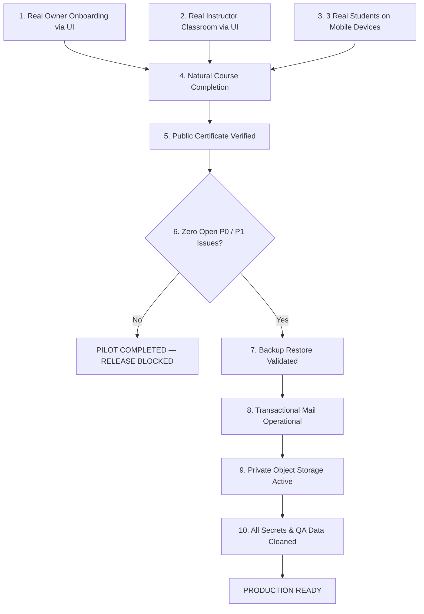

# AIN Platform — Production Release Decision Gate

**Document Version:** 1.0.0  
**Gate Evaluation Date:** October 19, 2026  
**Current Official Status:** `LIVE PRODUCTION QA DRILL PASSED — HUMAN PILOT PENDING`  
**Classification:** Executive & Engineering Release Decision Document  

---

## 1. Official Operational Status Declaration

The formal operational status of the AIN Platform is hereby designated as:

$$\mathbf{LIVE\ PRODUCTION\ QA\ DRILL\ PASSED\ —\ HUMAN\ PILOT\ PENDING}$$

> [!WARNING]
> Under strict platform policy, the system is **NOT** labeled `PRODUCTION READY` at this time.
> Passing automated test suites, Golden Flow simulations, and scripted API drills is necessary, but **not sufficient**, for general commercial release.

---

## 2. Rationale & Decision Framework

### 2.1. Why the Scripted QA Drill Does Not Equal Production Readiness
During the preceding phase, an automated end-to-end technical drill successfully verified:
- Academy profile creation and multi-tenant isolation.
- Course, cohort batch, and room provisioning.
- Student booking and offline payment recording (Mode B).
- Video streaming, dynamic QR attendance generation, and scan verification.
- Assignment submission, instructor grading, and auto-graded examinations.
- Course completion evaluation and cryptographic certificate issuance.

However, this entire lifecycle was orchestrated with deterministic scripts, simulated payloads, and fixed timing. It demonstrated that the **software machinery works**, but it did **not** prove that:
1. Real educators can navigate the UX without confusion.
2. Real students on diverse mobile devices and cellular connections experience friction-free learning.
3. Educational terminology and button placements match intuitive user mental models.
4. Uncoached humans can complete courses and obtain valid certificates without developer intervention.

Therefore, commercial release is gated upon genuine human pilot execution.

---

## 3. Review of Completed Gates

| Gate | Scope | Status | Evidence Reference |
| :--- | :--- | :---: | :--- |
| **Gate 1: Core Technical Readiness** | Full Laravel test suite, Golden E2E workflow, and tenant isolation tests. | ✅ **PASSED** | `tests/Feature/GoldenEndToEndWorkflowTest.php` (33 assertions, 0 failures) |
| **Gate 2: Pilot Architectural Gate** | Configurable completion policies, privacy-preserving certificates, and Mode B offline payments. | ✅ **PASSED** | `tests/Feature/PilotAcademyWorkflowTest.php` (40 assertions, 0 failures) |
| **Gate 3: Security Cleanup & Hardening** | Static MFA bypass removal in production, seeder guards, credential rotation protocol, and analytics data fencing. | ✅ **PASSED** | `docs/SECURITY_CLEANUP_REPORT.md` & `SuperAdminMfaTest.php` (28 assertions) |
| **Gate 4: Mode B Offline Payment UI** | Front-end modal for recording offline payments (Cash, InstaPay, Bank Transfer, Scholarship, Free) with audit trail. | ✅ **PASSED** | `01-Frontend-Web/src/components/MarketplaceAdminOperations.jsx` |
| **Gate 5: Human Pilot Usability Gate** | Real human users (1 Owner, 1 Instructor, 3 Students) operating exclusively via browser UI. | ⏳ **PENDING FIELD RUN** | `docs/HUMAN_PILOT_RUNBOOK.md` & `docs/HUMAN_PILOT_RESULTS.md` |

---

## 4. Promotion Criteria: Pathway to `PRODUCTION READY`

The transition from `HUMAN PILOT IN PROGRESS` to `PRODUCTION READY` requires strict compliance with all 10 criteria below:

### Detailed Criteria Checklist:
1. **Real Academy Owner:** At least 1 real human Owner must configure branding, courses, batches, and completion policies entirely via the browser UI without console or developer guidance.
2. **Real Instructor:** At least 1 real human Instructor must schedule sessions, generate dynamic attendance QR codes, and grade student submissions via the UI.
3. **Three Real Students:** At least 3 real human students must register, access rooms, watch videos, submit assignments, and take quizzes on real mobile devices (iOS Safari and Android Chrome).
4. **Natural Completion:** At least 1 student must satisfy all 4 completion pillars naturally without artificial database progress injection.
5. **Certificate Verification:** Generated certificate must resolve publicly via clean URL, displaying student name and course, while hiding email, phone, and internal UUIDs, with appropriate classification.
6. **Zero Critical / Blocker Defects:** Exactly **0 P0** issues and **0 P1** issues remaining unresolved.
7. **Disaster Recovery:** Database backup creation and restore test executed and confirmed valid.
8. **Transactional Email:** External transactional email provider (Brevo / SendGrid / SES) actively delivering invitations, OTPs, and notifications to external inboxes.
9. **Private Asset Storage:** Learning documents and assignment uploads stored in private object storage (R2 / S3) with short-lived signed URLs ($\le 15$ minutes).
10. **Sanitized Environment:** No static MFA codes, demo credentials, reusable passwords, or sensitive tokens present in code, logs, or documentation.

---

## 5. Controlled Status Nomenclature

The engineering and product teams must strictly use the following status strings:

| Lifecycle State | Exact Status String | Permitted Usage |
| :--- | :--- | :--- |
| **Current State** | `LIVE PRODUCTION QA DRILL PASSED — HUMAN PILOT PENDING` | All technical gates and security cleanups have passed. Human testing has not yet commenced. |
| **Testing State** | `HUMAN PILOT IN PROGRESS` | Human participants (Owner, Instructor, Students) are actively executing the browser test runbook. |
| **Triage State** | `PILOT COMPLETED — RELEASE BLOCKED` | Human testing concluded, but one or more P0 or P1 issues remain unresolved. |
| **Commercial State** | `PRODUCTION READY` | All 10 promotion criteria verified, audited, and signed off by Lead Architect. |

---

## 6. Executive Release Determination

**Decision:**  
The platform is approved to proceed immediately to **Human Pilot Field Testing** using `docs/HUMAN_PILOT_RUNBOOK.md`.  
The platform **remains gated** from General Commercial Availability (`PRODUCTION READY`) until all 10 promotion criteria are fulfilled and verified.

**Sign-off:**  
Senior Product Designer, UX Architect & Senior Backend Engineer  
AIN Platform Engineering Team
